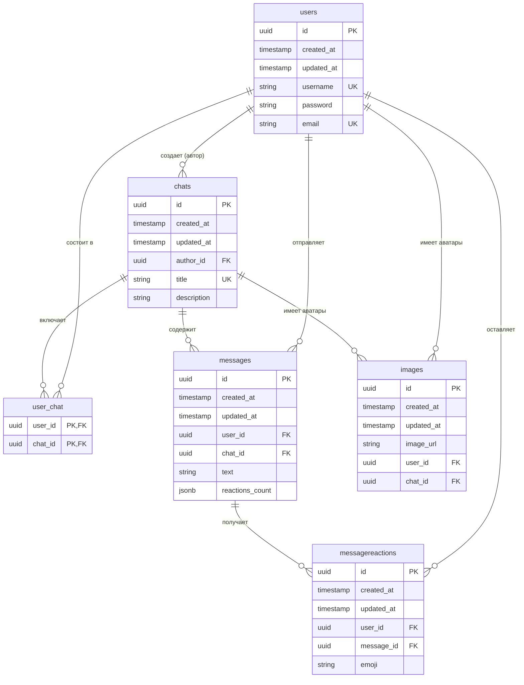

# Spark
[](https://github.com/Chernov2312/Spark/actions/workflows/ci_linter_test.yml)
[](https://github.com/Chernov2312/Spark/actions/workflows/ci_python_test.yml)
## 🛠 Необходимое ПО

Перед запуском проекта убедитесь, что у вас установлены:

* 🐋 [**Docker** (версия 20.10 или выше)](https://docs.docker.com/desktop/setup/install/windows-install/)

---

## 🚀 Инструкция по запуску

Проект полностью контейнеризирован. Запуск базы данных, создание таблиц и старт приложения происходят автоматически.

### 1. Подготовка окружения
Скопируйте шаблон конфигурации в рабочий файл `.env`:

```bash
cp env.example .env
```

*После копирования вы можете открыть файл `.env` и отредактировать доступы к базе данных, если дефолтные вам не подходят.*

### 2. Запуск проекта
Выполните следующую команду в корневой директории:

```bash
docker-compose up --build
```

#### Подвал


----
#### Разработчики

*  **Булычев Владимир** — Основатель идеи / Backend-разработчик
*  **Чернов Максим** — Тимлид / Ведущий Backend-разработчик
*  **Малыгин Артём** — Профессиональный вайбкодер / Frontend-разработчик
