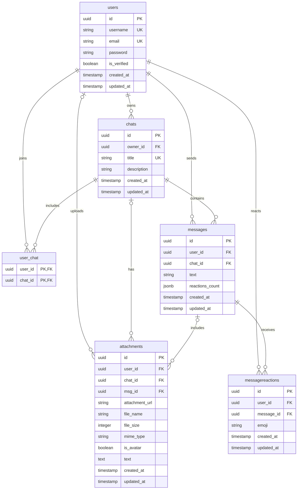

# Spark

[](https://github.com/Chernov2312/Spark/actions/workflows/ci_linter_test.yml)
[](https://github.com/Chernov2312/Spark/actions/workflows/ci_python_test.yml)

Spark — мессенджер с REST API и WebSocket-соединениями. Серверная часть написана на FastAPI, использует PostgreSQL для постоянных данных и Redis для обмена сообщениями и фоновой синхронизации.

## Возможности бэкенда

- Регистрация с подтверждением электронной почты, вход и JWT-аутентификация.
- Профили пользователей и чаты с участниками.
- Сообщения, вложения и реакции.
- WebSocket-подключение к чату для обмена событиями и статусом набора текста.
- Генерация краткого содержания переписки и переписывание текста с помощью Gemini.
- Хранение файлов в S3-совместимом объектном хранилище Yandex Cloud.
- Фоновые задачи Celery: отправка писем, распознавание аудио через Whisper и синхронизация сообщений и реакций.

## Требования

- Docker Desktop с поддержкой Docker Compose.
- Для использования внешних интеграций нужны учетные данные Yandex Cloud, Google Gemini и SMTP.

Контейнер бэкенда собран на Python 3.13 и устанавливает FFmpeg, необходимый для обработки аудио.

## Запуск для разработки

Все команды выполняются из корня репозитория.

1. Создайте локальный файл окружения из шаблона.

   PowerShell:

   ```powershell
   Copy-Item .env.example .env
   ```

   macOS/Linux:

   ```bash
   cp .env.example .env
   ```

2. При необходимости задайте в `.env` значения для PostgreSQL, Redis, JWT и внешних интеграций. Для реальной отправки почты и работы с файлами и ИИ замените демонстрационные значения на действительные учетные данные.
3. Запустите сервисы разработки:

   ```bash
   docker compose --profile dev up --build
   ```

Профиль `dev` запускает PostgreSQL, Redis, бэкенд, Celery worker и beat, а также фронтенд. При запуске бэкенд применяет миграции Alembic автоматически.

После запуска:

- API: <http://localhost:8001>
- Swagger UI: <http://localhost:8001/docs>
- OpenAPI-схема: <http://localhost:8001/openapi.json>
- Проверка состояния бэкенда: <http://localhost:8001/health>
- Фронтенд: <http://localhost:5174>
- PostgreSQL: `localhost:5432`
- Redis: `localhost:6380` (внутри Docker-сети — `redis:6379`)

Остановка сервисов без удаления данных:

```bash
docker compose --profile dev down
```

## API и WebSocket

Основные HTTP-маршруты находятся под `/api/v1`:

| Раздел | Маршруты |
| --- | --- |
| Аутентификация | `/api/v1/auth` |
| Пользователи | `/api/v1/users` |
| Чаты | `/api/v1/chats` |
| Сообщения | `/api/v1/chats/{chat_id}/messages`, `/api/v1/messages/{message_id}` |
| Реакции | `/api/v1/messages/{message_id}/reactions` |
| Вложения | `/api/v1/attachments/` |
| ИИ | `/api/v1/ai/chats/{chat_id}/summarize`, `/api/v1/ai/messages/rewrite` |

Большинство маршрутов требуют JWT-токен. Подробные параметры и схемы запросов доступны в Swagger UI после запуска сервера.

WebSocket для чата подключается по адресу `ws://localhost:8001/{chat_id}/ws?token=<JWT>`.

## Разработка и тесты бэкенда

Исходный код бэкенда расположен в `backend/`: HTTP/WebSocket-маршруты — в `api/v1/`, модели и доступ к данным — в `db/`, настройки и общая логика — в `config/` и `core/`, фоновые задачи — в `tasks/`.

Для запуска тестов в Docker используйте отдельное тестовое окружение:

```bash
docker compose --env-file .env.test -f docker-compose.test.yml up -d --build
docker compose --env-file .env.test -f docker-compose.test.yml exec backend-test pytest
docker compose --env-file .env.test -f docker-compose.test.yml down
```

Тестовый Compose-файл поднимает изолированные PostgreSQL и Redis. Тестовые настройки находятся в `.env.test`.

## Модель данных



## Разработчики

- **Булычев Владимир** — основатель идеи / Backend-разработчик
- **Чернов Максим** — тимлид / DevOps / ведущий Backend-разработчик
- **Малыгин Артём** — Frontend-разработчик
