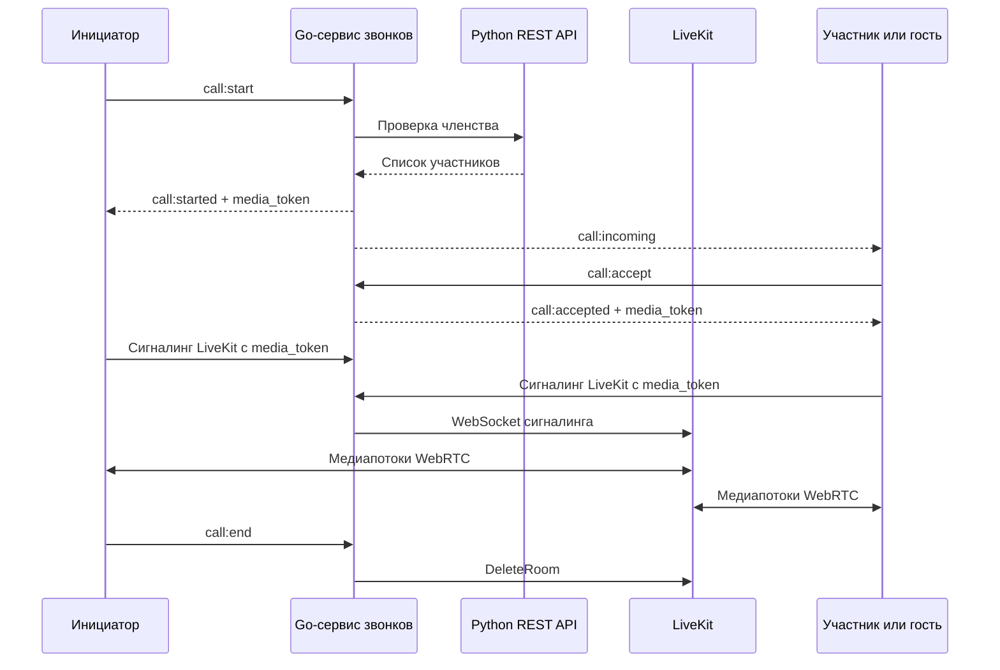

# Spark — REST и WebSocket API

Документация описывает маршруты, зарегистрированные в текущем бэкенде. Актуальные интерактивные схемы FastAPI доступны по адресу `/docs`, OpenAPI — `/openapi.json`; проверка состояния — `GET /health`.

HTTP API использует префикс `/api/v1`. Защищённые маршруты принимают access JWT в заголовке:

```http
Authorization: Bearer <access_token>
```

## 1. Аутентификация — `/api/v1/auth`

### `POST /api/v1/auth/register`

Создает пользователя и ставит задачу отправки письма с подтверждением. До подтверждения email access token не выдается.

Запрос (`application/json`):

```json
{
  "username": "john_doe",
  "tag": "john_doe",
  "email": "john@example.com",
  "password": "StrongPass123"
}
```

Поле `tag` необязательно: если его не передать, сервер создаст свободный тег на основе имени пользователя. Теги нормализуются и уникальны.

Ответ `201 Created`:

```json
{
  "id": "11111111-eeee-aaaa-bbbb-cccccccccccc",
  "username": "john_doe",
  "tag": "john_doe",
  "email": "john@example.com",
  "verification_required": true
}
```

Ссылка в письме ведет на `FRONTEND_BASE_URL/verify-email/{verification_token}`. Фронтенд показывает страницу подтверждения и отправляет `GET /api/v1/auth/verification/{verification_token}`. После успешной проверки API возвращает пользователя и access token; фронтенд сохраняет токен и открывает страницу чатов.

### `POST /api/v1/auth/login`

Вход принимает `application/x-www-form-urlencoded` (или `multipart/form-data`) с полями `username` и `password`. В поле `username` передаётся адрес электронной почты (до 100 символов); регистр адреса и пробелы по краям игнорируются. Вход по тегу или имени пользователя не поддерживается.

Ответ `200 OK` содержит пользователя, JWT в `access_token` и устанавливает refresh cookie. Для неподтвержденного аккаунта возвращается `403 Forbidden`, для неверных учетных данных — `401 Unauthorized`.

### `GET /api/v1/auth/verification/{verification_token}`

Подтверждает email по токену из письма, возвращает пользователя с новым access token и устанавливает refresh cookie (`200 OK`). Повторное использование действующего токена также создаёт сессию. Недействительный или просроченный токен приводит к `401 Unauthorized`.

### `POST /api/v1/auth/refresh`

Принимает cookie `spark_refresh_token` без тела и без заголовка `Authorization`. Возвращает `200 OK` с `{"access_token": "<JWT>", "token_type": "bearer"}` и новой cookie. Предыдущий refresh-токен перестаёт действовать сразу после ротации. Отсутствующая, просроченная или отозванная сессия возвращает `401 Unauthorized`.

Refresh-токен хранится в cookie с `HttpOnly`, `SameSite=Lax` и путём `/api/v1/auth`. Для HTTPS-адреса в `FRONTEND_BASE_URL` сервер устанавливает `Secure`. В PostgreSQL хранится хеш токена. Срок access-токена задаёт `ACCESS_TOKEN_EXPIRE_MINUTES`, срок всей refresh-сессии — `REFRESH_TOKEN_EXPIRE_DAYS` (по умолчанию 30 дней с момента входа). Ротация не продлевает этот срок. Браузер отправляет запросы с cookie с origin из `FRONTEND_BASE_URL` или с локального frontend на порту 5173 либо 5174.

### `POST /api/v1/auth/logout`

Отзывает текущую refresh-сессию по cookie, удаляет cookie и возвращает `204 No Content`. Сброс пароля отзывает все refresh-сессии аккаунта. Уже выданные access-токены действуют до истечения срока.

## 2. Пользователи — `/api/v1/users`

### `GET /api/v1/users/me`

Возвращает профиль текущего пользователя (`200 OK`):

```json
{
  "id": "11111111-eeee-aaaa-bbbb-cccccccccccc",
  "username": "john_doe",
  "email": "john@example.com",
  "avatar_urls": ["https://storage.example/signed-avatar-url"],
  "created_at": "2026-10-03T09:21:00Z"
}
```

`avatar_urls` содержит временные ссылки на изображения из хранилища. Записи аватаров без ключа хранилища пропускаются при чтении и обновлении профиля.

### `PATCH /api/v1/users/me`

Обновляет имя пользователя и/или адрес электронной почты. Оба поля необязательны.

Запрос:

```json
{
  "username": "new_john_doe",
  "email": "new_email@example.com"
}
```

Ответ — объект профиля (`200 OK`). Несуществующий пользователь приводит к `404 Not Found`.

### `POST /api/v1/users/me/delete/avatar`

Запрос принимает `Avatar` с полем `url` (`application/json`). Здесь передается ключ объекта из хранилища (`file_key`), а не временная URL-ссылка:

```json
{
  "url": "user_avatar/11111111-eeee-aaaa-bbbb-cccccccccccc/2026-10-28_12-00-00.webp"
}
```

При успешном удалении ожидается `204 No Content`; если вложение не найдено для текущего пользователя — `404 Not Found`. Текущая реализация вызывает `S3Storage.delete_avatar`, которого нет в `S3Storage`; удаление поэтому не завершится успешно.

Отдельного маршрута `POST /users/me/avatar` нет. Чтобы зарегистрировать пользовательский аватар, используйте общий media-поток: временная ссылка с `type: "user_avatar"`, прямая загрузка `PUT`, затем создание вложения с `chat_id: null` и `is_avatar: true`.

## 3. Чаты — `/api/v1/chats`

### Создание группы, поиск участников и аватары

Форма создания отправляет `POST /api/v1/chats` с `id: null`, списком `invited_user_ids` (UUID выбранных пользователей) и пустым `avatar_urls`. Название и описание обязательны.

Поиск участников выполняется по username:

```http
GET /api/v1/users/search?username=john&limit=20
```

Ответ:

```json
{
  "users": [
    {
      "id": "11111111-eeee-aaaa-bbbb-cccccccccccc",
      "username": "john_doe",
      "avatar_urls": []
    }
  ]
}
```

Выбранные идентификаторы передаются при создании группы. Для уже созданной группы участников можно добавить через `POST /api/v1/chats/{chat_id}/users` с телом `{"user_ids": ["<user_id>"]}`.

Группа может иметь несколько изображений. Для каждого файла frontend запрашивает временный URL с `type: "chat_avatar"` и `target_id` группы, загружает файл прямым HTTP `PUT`, затем регистрирует вложение через `POST /api/v1/attachments/` с `chat_id`, `is_avatar: true`, `file_key`, `file_name`, `file_size` и `mime_type`. Все изображения отображаются из массива `avatar_urls`, возвращаемого `GET /api/v1/chats`.

Общее фото чата могут менять только владелец и модераторы. Для обычных участников кнопка загрузки скрыта; запрос временной ссылки с `type: "chat_avatar"` и регистрация вложения с `chat_id` и `is_avatar: true` возвращают `403 Forbidden`. При отсутствии чата возвращается `404`, при некорректном UUID в `target_id` — `422`. Права проверяются заново при регистрации, даже если ссылка была выдана до понижения роли. Личная картинка чата по-прежнему доступна любому участнику.

### `GET /api/v1/chats`

`personal_avatar_url` — подписанная ссылка на личную картинку чата для текущего пользователя или `null`, если используется общая. Картинки других пользователей не возвращаются.

Возвращает список чатов текущего пользователя (`200 OK`):

Поле `last_message` содержит `null` для пустого чата либо объект с `id`, `user_id`, `text`, `created_at`, `is_forwarded`, `thread_root_id` и `attachments` (только `file_name` и `mime_type`). Последнее сообщение выбирается по времени из PostgreSQL и очереди Redis, включая ответы в тредах.

```json
{
  "chats": [
    {
      "id": "33333333-eeee-aaaa-bbbb-cccccccccccc",
      "title": "Команда разработки",
      "description": "Рабочий чат проекта",
      "owner_id": "11111111-eeee-aaaa-bbbb-cccccccccccc",
      "created_at": "2026-10-01T12:00:00Z",
      "updated_at": "2026-10-03T09:25:00Z",
      "avatar_urls": []
    }
  ]
}
```

### `POST /api/v1/chats`

Создает чат. `id` — обязательное nullable-поле (передайте `null` для создания нового чата); `title` обязателен (до 50 символов), `description` обязателен (до 150 символов), `invited_user_ids` — обязательный массив UUID (может быть пустым). `avatar_urls` — необязательный массив строк.

Запрос:

```json
{
  "id": null,
  "title": "Новая группа",
  "description": "Обсуждение интеграции",
  "invited_user_ids": ["22222222-eeee-aaaa-bbbb-cccccccccccc"],
  "avatar_urls": []
}
```

Ответ `201 Created` включает `id`, `owner_id`, `title`, `description`, `invited_user_ids`, `users_count`, `created_at` и `avater_urls` (именно так поле названо в текущей схеме ответа).

### `PATCH /api/v1/chats/{chat_id}`

Редактирует чат. Запрос требует оба поля — `title` (до 50 символов) и `description` (до 150 символов), несмотря на использование метода `PATCH`. Изменять чат может только его владелец.

Ответ `200 OK` — объект чата. Возможные ошибки: `404 Not Found`, `403 Forbidden`.

### `GET /api/v1/chats/{chat_id}/members`

Доступен только участникам чата; для отсутствующего чата или постороннего пользователя возвращает `404`. Возвращает массив участников, упорядоченный по роли (владелец, модераторы, участники), затем по имени:

```json
[
  {
    "id": "11111111-eeee-aaaa-bbbb-cccccccccccc",
    "username": "Анна",
    "tag": "anna",
    "role": "owner",
    "last_read_message_id": null,
    "avatar_urls": [],
    "created_at": "2026-01-01T12:00:00"
  }
]
```

`created_at` — дата регистрации пользователя. `avatar_urls` содержит временные подписанные ссылки на фотографии профиля в порядке создания, от старых к новым; последняя используется как аватар. Общие аватары чатов не включаются. Email и другие приватные поля не возвращаются. Frontend использует эти данные для списка участников и карточки профиля.

### `POST /api/v1/chats/{chat_id}/read`

Участник чата передаёт `{"message_id": "UUID"}` и получает `200` с полем `last_read_message_id`. Можно отметить сообщение сразу после отправки, пока оно ещё находится в очереди Redis. Для неизвестного ID или сообщения из другого чата сервер возвращает `422`. Значение `null` сбрасывает отметку. Изменение публикуется в чате событием WebSocket `user:read`.

### `POST /api/v1/chats/{chat_id}/users`

Добавляет пользователей в чат. Только владелец чата может добавлять участников.

Запрос:

```json
{
  "user_ids": ["22222222-eeee-aaaa-bbbb-cccccccccccc"]
}
```

Ответ `200 OK`:

```json
{
  "status": "success"
}
```

В текущей реализации нет HTTP-маршрутов для удаления участника или выхода из чата. Аватары пользователя и чата используют общий media-поток ниже с `type` соответственно `user_avatar` и `chat_avatar`; отдельного маршрута загрузки аватара чата нет.

### Личная картинка чата

Для загрузки запросите `POST /api/v1/attachments/temporary-url` с `type: "personal_chat_avatar"`, UUID чата в `target_id`, `file_content` (MIME изображения) и `file_extension`. Доступ есть у любого участника чата. Загрузите файл через `PUT` на выданный `temporary_url`, затем сохраните выбор:

- `PUT /api/v1/chats/{chat_id}/personal-avatar` — тело `{"file_key": "ключ из шага загрузки"}`; проверяет принадлежность ключа пользователю и чату, наличие объекта, MIME и размер до 5 МБ.
- `DELETE /api/v1/chats/{chat_id}/personal-avatar` — возвращает общую картинку.

Оба маршрута возвращают `{"personal_avatar_url": "подписанная ссылка или null"}`. Настройка хранится в `chat_appearances` с уникальной парой `(user_id, chat_id)` и удаляется при удалении участия в чате. Личная картинка не публикуется в общий WebSocket и не меняет общие `avatar_urls`.

## 4. Сообщения

### `GET /api/v1/chats/{chat_id}/messages`

Возвращает историю чата (`200 OK`).

Query-параметры:

- `limit` — количество сообщений, по умолчанию `50`.
- `before` — дата и время в формате ISO 8601; используется как курсор.

Ответ:

```json
{
  "messages": [
    {
      "id": "44444444-eeee-aaaa-bbbb-cccccccccccc",
      "chat_id": "33333333-eeee-aaaa-bbbb-cccccccccccc",
      "user_id": "11111111-eeee-aaaa-bbbb-cccccccccccc",
      "text": "Привет всем!",
      "user_reaction": "👍",
      "attachments": [
        {
          "chat_id": "33333333-eeee-aaaa-bbbb-cccccccccccc",
          "file_key": "https://storage.example.com/user_message/11111111-eeee-aaaa-bbbb-cccccccccccc/image.jpg?X-Amz-Signature=example",
          "file_name": "image.jpg",
          "file_size": 2048,
          "mime_type": "image/jpeg",
          "text": null
        }
      ],
      "reactions_count": {
        "👍": 3
      },
      "created_at": "2026-10-03T09:10:00Z"
    }
  ]
}
```

`user_reaction` и `text` могут быть `null`; `attachments` и `reactions_count` могут быть пустыми.
В истории `file_key` вложения содержит временную ссылку на файл. Вложения без ключа хранилища пропускаются, а само сообщение остаётся в истории.

### `POST /api/v1/chats/{chat_id}/messages`

Отправляет сообщение (`201 Created`). Требуется хотя бы непустой текст или одно вложение. Максимум 10 вложений. Текст может быть `null`.

Запрос (`application/json`):

```json
{
  "text": "Посмотрите на этот макет",
  "attachments": [
    {
      "chat_id": "33333333-eeee-aaaa-bbbb-cccccccccccc",
      "file_key": "user_message/11111111-eeee-aaaa-bbbb-cccccccccccc/file.webp",
      "file_name": "image.jpg",
      "file_size": 2048,
      "mime_type": "image/jpeg",
      "text": null
    }
  ]
}
```

Вложение передается объектом, а не UUID. `file_key` — ключ объекта, полученный в ответе media-маршрута; `file_size` должен быть неотрицательным числом. Вложение требует `chat_id`, `file_key`, `file_name`, `file_size` и `mime_type`; `text` необязателен.

Для ответа в треде передайте необязательный `thread_root_id` — UUID корневого сообщения в этом чате. `reply_to_id` сохраняет отдельное значение цитаты и может использоваться вместе с ним.

При отправке, редактировании и пересылке клиент может передать `link_preview_url` с выбранным HTTP(S)-адресом из текста сообщения. Для адреса вида `www.example.org` клиент добавляет `https://`. Если поле отсутствует или равно `null`, задача разбора не ставится. Сервер проверяет переданный адрес и его наличие в тексте, сохраняет выбор в сообщении и передаёт его в Celery-задачу `tasks.link_preview.parse_link_preview_task` вместе с `chat_id` и `message_id`. Задача извлекает заголовок и описание из HTML публичной страницы. Готовый результат хранится в Redis семь дней. В ответах истории, тредов, поиска и закреплений поле `link_preview` содержит `{ "url": "...", "title": "...", "description": "..." }` или `null`. Описание может быть `null`.

Ответ содержит `id`, `chat_id`, `user_id`, `text`, `user_reaction`, `attachments`, `reactions_count` и `created_at`. Схема `AttachmentRequest` задает `file_key`, тогда как обработчик формирует вложения ответа с `attachment_url`; проверьте фактический ответ после исправления этого несоответствия.

### `GET /api/v1/chats/{chat_id}/messages/{root_message_id}/thread`

Возвращает корневое сообщение и ответы в треде по возрастанию времени. `limit` ограничен 200 ответами; `before` загружает более ранние ответы. Ответы треда не включаются в основную историю чата. Доступен только участникам чата; корень должен быть сообщением верхнего уровня.

### `GET /api/v1/chats/{chat_id}/threads`

Возвращает `{"messages": [...]}` со всеми корневыми сообщениями тредов чата, у которых есть ответы, включая сообщения из очереди Redis. Требует участия в чате. Корни содержат `thread_reply_count`.

### `POST /api/v1/chats/{chat_id}/messages/{message_id}/forward`

Тело: `{"target_chat_id": "UUID"}`. Требует участия в исходном и целевом чатах. Создаёт отдельное сообщение с копией текста и записей вложений; вложения получают новые ID и целевой `chat_id`, сохраняя ключ объекта хранилища. Работает и для исходного сообщения, ожидающего записи из Redis. Возвращает новое сообщение (`201`) и публикует `message:new` в целевой чат. Цитата и принадлежность исходному треду не копируются.

У пересланной копии `is_forwarded` равно `true` в ответе на пересылку, событиях WebSocket, истории, поиске, закреплениях и превью последнего сообщения. Значение выставляет сервер. У сообщений, сохранённых до миграции `ab24d39e0751`, значение равно `false`, поскольку прежняя версия не сохраняла факт пересылки.

### `PUT /api/v1/messages/{message_id}`

Редактирует сообщение текущего пользователя. Тело запроса соответствует `MessageRequest`: можно передать текст, вложения или оба поля, но сообщение не должно быть пустым. Ответ — объект сообщения (`200 OK`). Если сообщение не найдено или пользователь не имеет права его редактировать — `404 Not Found`.

### `DELETE /api/v1/messages/{message_id}`

Удаляет сообщение текущего пользователя. Успешный ответ — объект удаленного сообщения (`200 OK`); если сообщение не найдено или пользователь не имеет права его удалять — `404 Not Found`.

## 5. Реакции — `/api/v1/messages/{message_id}/reactions`

Реакции обрабатываются через Redis и синхронизируются с базой данных фоновой задачей Celery.

### `POST /api/v1/messages/{message_id}/reactions`

Добавляет реакцию, переключает реакцию на другой emoji или снимает ее, если пользователь повторно отправил тот же emoji. Тело запроса:

```json
{
  "emoji": "🔥"
}
```

Поле `emoji` ограничено 10 символами. Ответ `200 OK`:

```json
{
  "message_id": "44444444-eeee-aaaa-bbbb-cccccccccccc",
  "updated_reactions_count": {
    "🔥": 1
  }
}
```

### `DELETE /api/v1/messages/{message_id}/reactions`

Удаляет реакцию текущего пользователя, если она есть. Ответ `200 OK` содержит `message_id` и актуальный `updated_reactions_count`.

### Закреплённые сообщения

`GET /api/v1/chats/{chat_id}/messages/pinned` возвращает `{"messages": [...]}` с полными объектами `MessageResponse`, включая `is_pinned: true`, вложения и `thread_root_id` для ответов в тредах. Сообщения упорядочены по времени закрепления, от новых к старым; список не ограничен страницей истории. Доступен только участникам: `403` для постороннего пользователя, `404` для отсутствующего чата.

`PUT /api/v1/chats/{chat_id}/messages/{message_id}/pin` переключает закрепление и возвращает `{"pinned": true}` или `{"pinned": false}`. Участники чата получают событие `message:updated` с полным сообщением и актуальным `is_pinned`. Кеш истории инвалидируется. Поиск, история, треды и редактирование сохраняют корректный признак `is_pinned`.

### Опросы и викторины

`POST /api/v1/chats/{chat_id}/polls` создаёт сообщение с опросом, ответ — `201 Created` с `MessageResponse`. Поле `poll_id` присутствует в истории, поиске, тредах, закреплениях и событии `message:new`; у обычных сообщений оно `null`.

```json
{
  "question": "Какой вариант верный?",
  "options": ["Первый", "Второй", "Третий"],
  "is_anonymous": true,
  "allow_retract": false,
  "is_quiz": true,
  "correct_option_index": 1,
  "thread_root_id": null
}
```

Вопрос — 1–300 символов после обрезки пробелов, вариантов — 2–10, каждый 1–150 символов. Пустые и повторяющиеся варианты запрещены. `is_anonymous` и `allow_retract` по умолчанию `true`, `is_quiz` — `false`. Для викторины обязателен `correct_option_index` (индекс с нуля); для обычного опроса он должен быть `null` или отсутствовать. Голосование всегда с выбором одного варианта. `thread_root_id` позволяет создать опрос в треде текущего чата.

- `GET /api/v1/polls/{poll_id}` — персональное состояние опроса.
- `PUT /api/v1/polls/{poll_id}/vote` — голосование, тело `{"option_id": "UUID варианта"}`.
- `DELETE /api/v1/polls/{poll_id}/vote` — отмена ответа.

Все три маршрута возвращают `PollResponse`: `id`, `message_id`, `chat_id`, `question`, `is_anonymous`, `allow_retract`, `is_quiz`, `is_creator`, `total_votes`, `my_option_id`, `correct_option_id`, `version` и `options`. Каждый вариант содержит `id`, `text`, `votes_count`, `voters`. Для анонимного опроса `voters: null` у всех вариантов, в том числе для автора; для открытого — массив `{id, username, tag}`. `my_option_id` описывает только ответ запрашивающего пользователя. Правильный вариант викторины скрыт до голосования (`correct_option_id: null`); автор видит его сразу. Отмена разрешённого голоса снова скрывает правильный вариант, но уже полученную информацию нельзя отозвать: в таком режиме пользователь может ответить заново после оценки.

Если `allow_retract: false`, смена и отмена уже поданного ответа возвращают `409 Conflict`. Повтор того же ответа идемпотентен и не добавляет голосов. Уникальность голоса гарантируется БД; параллельные запросы сериализуются блокировкой опроса. Вариант из другого опроса возвращает `422`. Доступ только участникам чата (`403` для постороннего); отсутствующий опрос возвращает `404`.

После изменения голосов участники получают:

```json
{
  "event": "poll:updated",
  "data": {
    "chat_id": "UUID чата",
    "poll_id": "UUID опроса",
    "message_id": "UUID сообщения",
    "version": 2
  }
}
```

Общее событие не содержит имён, выбранных вариантов или правильного ответа. Клиент перечитывает персональное состояние через `GET /polls/{poll_id}`. `version` растёт при изменении голосов и позволяет обработать гонку события с фиксацией транзакции.

Опросы сохраняются в `polls`, `poll_options`, `poll_votes`; удаление сообщения каскадно удаляет опрос и голоса. Редактирование и пересылка сообщения с опросом возвращают `422`; ответы, треды, закрепление и удаление автором поддерживаются. Миграция: `e8c2a490b517_chat_polls`.

## 6. Медиа и аватары — `/api/v1/attachments`

Файлы загружаются напрямую в объектное хранилище по временной ссылке. Один и тот же протокол используется для сообщений и аватаров; назначение задается полем `type`.

### Шаг 1. Получить временную ссылку — `POST /api/v1/attachments/temporary-url`

Требуется JWT. Запрос (`application/json`):

```json
{
  "file_extension": "webp",
  "file_content": "image/webp",
  "target_id": "11111111-eeee-aaaa-bbbb-cccccccccccc",
  "type": "user_avatar"
}
```

Поля:

- `file_extension` — расширение файла без точки.
- `file_content` — MIME-тип файла, например `image/webp` или `image/jpeg`.
- `target_id` — строковый идентификатор целевого пользователя или группы. Для `message` и `user_avatar` передается ID пользователя; для `chat_avatar` — ID группы.
- `type` — `message`, `user_avatar` или `chat_avatar`.

Для `user_avatar` и `chat_avatar` разрешены JPEG, PNG, WebP и GIF. Ответ содержит `temporary_url`, `file_key` и один из идентификаторов:

```json
{
  "user_id": "11111111-eeee-aaaa-bbbb-cccccccccccc",
  "chat_id": null,
  "temporary_url": "https://storage.example/presigned-put-url",
  "file_key": "user_avatar/11111111-eeee-aaaa-bbbb-cccccccccccc/2026-10-28_12-00-00.webp"
}
```

При `type: "chat_avatar"` ответ содержит UUID существующего чата из `target_id` в поле `chat_id`; ключ имеет префикс `chat_avatar/{chat_id}/`. Ссылка выдаётся только владельцу или модератору. При `type: "personal_chat_avatar"` возвращаются оба идентификатора, а при `message` и `user_avatar` — `user_id`. Реализация использует временную ссылку как URL для HTTP `PUT`.

Запрос для аватара чата отличается только значением `type` и идентификатором:

```json
{
  "file_extension": "webp",
  "file_content": "image/webp",
  "target_id": "33333333-eeee-aaaa-bbbb-cccccccccccc",
  "type": "chat_avatar"
}
```

### Шаг 2. Загрузить файл по временной ссылке

Отправьте байты файла методом `PUT` непосредственно на `temporary_url`, передав `Content-Type`, соответствующий `file_content`. Не отправляйте этот запрос через API `/api/v1` и не добавляйте JWT к внешнему URL хранилища.

```http
PUT <temporary_url>
Content-Type: image/webp

<байты файла>
```

Для любого аватара используйте тот же маршрут временной ссылки:

| Назначение | `type` | `target_id` |
| --- | --- | --- |
| Аватар пользователя | `user_avatar` | UUID пользователя |
| Аватар чата | `chat_avatar` | UUID чата |

### Шаг 3. Зарегистрировать вложение — `POST /api/v1/attachments/`

После успешного `PUT` зарегистрируйте вложение (`application/json`). Для сообщения передайте UUID чата и `is_avatar: false` (или опустите необязательный флаг); для пользовательского аватара — `chat_id: null` и `is_avatar: true`:

```json
{
  "chat_id": "33333333-eeee-aaaa-bbbb-cccccccccccc",
  "is_avatar": false,
  "file_key": "user_message/11111111-eeee-aaaa-bbbb-cccccccccccc/2026-10-28_12-00-00.webp",
  "file_name": "image.webp",
  "file_size": 2048,
  "mime_type": "image/webp",
  "text": null
}
```

Схема `AttachmentRequest` требует `chat_id` (nullable, но поле обязательно), `file_key`, `file_name`, `file_size` и `mime_type`; `is_avatar` по умолчанию `false`, `text` необязателен. Схема ответа `AttachmentResponse` содержит `id`, `attachment_url`, `file_name`, `file_size`, `mime_type`, `text`, `user_id` и `chat_id`.

Пример регистрации аватара пользователя:

```json
{
  "chat_id": null,
  "is_avatar": true,
  "file_key": "user_avatar/11111111-eeee-aaaa-bbbb-cccccccccccc/2026-10-28_12-00-00.webp",
  "file_name": "avatar.webp",
  "file_size": 2048,
  "mime_type": "image/webp",
  "text": null
}
```

Для регистрации общего аватара передайте `chat_id` и `is_avatar: true`. Сервер повторно проверяет права владельца или модератора перед созданием вложения. Для личной картинки чата используйте отдельные маршруты `/chats/{chat_id}/personal-avatar`.

> **Аватары:** схема `AttachmentRequest` содержит `is_avatar`; чтобы пользовательский аватар попал в связь аватаров профиля, запись должна быть создана с `chat_id: null`, `is_avatar: true` и `file_key` загруженного объекта. Тип `user_avatar` в запросе временной ссылки сам по себе не создает запись в БД. Для удаления передавайте этот ключ в поле `url` маршрута `/users/me/delete/avatar`; текущий обработчик удаления также вызывает отсутствующий `S3Storage.delete_avatar`.

В `S3Storage.get_temporary_url` параметр `client_method` поддерживает назначение ссылки (`put_object` для загрузки, `get_object` для чтения). Временные ссылки для чтения, возвращаемые API, следует считать краткоживущими.

## 7. ИИ — `/api/v1/ai`

### `POST /api/v1/ai/chats/{chat_id}/summarize`

Создает краткое содержание сообщений чата. Параметр `limit` передается в query string и по умолчанию равен `100`; тело запроса не требуется.

Ответ `200 OK`:

```json
{
  "chat_id": "33333333-eeee-aaaa-bbbb-cccccccccccc",
  "summary": "Краткое содержание переписки.",
  "generated_at": "2026-10-03T09:26:00Z"
}
```

Для пустого чата возвращается `422 Unprocessable Entity`.

### `POST /api/v1/ai/messages/rewrite`

Переписывает текст в указанном режиме.

Запрос:

```json
{
  "text": "Я завтра опоздаю на встречу.",
  "mode": "professional"
}
```

Поддерживаются режимы `professional`, `friendly`, `fix_grammar`, `make_longer`. Если `mode` не указан, используется `professional`.

Ответ `200 OK`:

```json
{
  "original_text": "Я завтра опоздаю на встречу.",
  "modified_text": "К сожалению, завтра я опоздаю на встречу."
}
```

Маршрута для Smart Replies в текущей реализации нет.

## Фоновые уведомления Web Push

Все маршруты подписки требуют JWT текущего пользователя.

| Метод и путь | Назначение |
| --- | --- |
| `GET /api/v1/push/config` | Возвращает `{"public_key": "..."}`. Значение `null` означает, что VAPID не настроен. |
| `PUT /api/v1/push/subscription` | Создаёт или обновляет подписку браузера. Тело содержит `endpoint`, `keys` с полями `p256dh` и `auth`, а также необязательный объект `chat_options`. Ключи `chat_options` — UUID чатов, значения — объекты с флагами `muted` и `silent`. Успешный ответ имеет статус `204`. |
| `DELETE /api/v1/push/subscription` | Удаляет подписку текущего пользователя по переданному в теле `endpoint`. Успешный ответ имеет статус `204`. |

Celery отправляет уведомления при создании, пересылке и публикации опроса участникам чата с подпиской. Автор исключается из получателей. Подписки отключённых чатов пропускаются, а записи с ответом службы доставки `404` или `410` удаляются. Зашифрованные данные включают `chat_id`, `message_id` и флаг `silent`.

## 8. WebSocket

Подключение к чату:

```text
ws://localhost:8001/{chat_id}/ws?token=<access_token>
```

Токен передается в query-параметре `token`. После подключения сервер подписывается на Redis-канал чата. Все события должны быть JSON-объектами с полями `event` и `data`; неподдерживаемый тип события приводит к ошибке валидации.

### События клиента

#### `message:new`

Содержимое сообщения:

```json
{
  "event": "message:new",
  "data": {
    "id": "44444444-eeee-aaaa-bbbb-cccccccccccc",
    "chat_id": "33333333-eeee-aaaa-bbbb-cccccccccccc",
    "user_id": "11111111-eeee-aaaa-bbbb-cccccccccccc",
    "text": "Привет!",
    "attachments": []
  }
}
```

Для события требуются `id`, `chat_id`, `user_id` и `text`; `attachments` — массив строк, по умолчанию пустой. HTTP-отправка сообщений выполняется через `POST /api/v1/chats/{chat_id}/messages`.

Событие `message:link-preview` публикуется сервером после разбора ссылки. В `data` приходят `chat_id`, `message_id` и `preview` с полями `url`, `title` и `description`. Клиент сверяет URL с текущим текстом сообщения, поскольку результат может прийти после редактирования.

#### `user:typing`

```json
{
  "event": "user:typing",
  "data": {
    "chat_id": "33333333-eeee-aaaa-bbbb-cccccccccccc"
  }
}
```

Сервер устанавливает `user_id` отправителя и рассылает событие участникам канала чата.

#### `chat:update`

```json
{
  "event": "chat:update",
  "data": {
    "chat_id": "33333333-eeee-aaaa-bbbb-cccccccccccc",
    "title": "Новое название",
    "avatar_url": "https://storage.example/avatar"
  }
}
```

Событие пересылается через Redis другим подписчикам чата. HTTP API для обновления названия чата доступно отдельно через `PATCH /api/v1/chats/{chat_id}`.

#### `attachment:text`

Событие распознавания аудио в текущей схеме WebSocket задает поля `message_id`, `audio_url`, а также необязательные `user_id` и `text`. Обработчик фоновой задачи также обращается к `chat_id` в данных события, хотя в схеме `AttachmentText` это поле не объявлено. Поэтому контракт распознавания через WebSocket в текущей реализации несогласован; полагайтесь на него только после проверки исправленной схемы и реализации.

Событие `attachment:text`, опубликованное сервером после обработки аудио, содержит `message_id`, `text`, `user_id` и `audio_url`.

Сервер передает полученные события `message:new`, `chat:update` и `user:typing` через Redis-подписку. События `chat:updated`, `chat:typing`, `message:send`, `ai:typing` и `ai:stream_chunk` текущей схемой не поддерживаются.

## 9. Звонки, взаимодействие Go, Python и LiveKit

Go-сервис `calls/` предоставляет WebSocket сигналинга `/v1/calls/ws` и REST API для создания и отзыва гостевых ссылок. Проверка процесса доступна по `GET /health` на внутреннем адресе Go.

### Ответственность сервисов

- **Python (текущий backend)** остается источником данных для пользователей, JWT, чатов и членства. Go не подключается напрямую к Python-базе данных.
- **Go** держит WebSocket-сессии, проверяет членство, выпускает токены LiveKit, управляет звонками и приглашениями. Активные звонки и приглашения живут в памяти одного экземпляра. Перезапуск завершает звонки и отзывает ссылки.
- **LiveKit** принимает аудио, камеру и демонстрацию экрана через WebRTC и пересылает дорожки подписанным участникам.

### Аутентификация и проверка участников

Фронтенд открывает отдельный WebSocket, заданный через `VITE_CALLS_WS_URL` (например, `ws://localhost:8002/v1/calls/ws`; в production — `wss://...`). Первым сообщением он отправляет:

```json
{
  "event": "auth",
  "data": { "access_token": "<JWT>" }
}
```

Go подтверждает идентичность через Python по внутреннему адресу с тем же токеном:

1. `GET /api/v1/users/me` с `Authorization: Bearer <JWT>`: Python валидирует токен и возвращает UUID пользователя.
2. Перед созданием или принятием звонка Go вызывает `GET /api/v1/chats/{chat_id}/members` с тем же заголовком. Этот существующий маршрут возвращает `404`, если запрашивающий пользователь не участник чата. Go сверяет UUID из списка с UUID пользователя из шага 1.
3. При успехе Go отвечает `auth:ok`. При отказе Go отправляет `auth:error` с полями `code` и `message` и закрывает соединение.

В одном чате может быть один активный звонок. Входящий вызов получают участники, подключённые к сервису в момент начала. Остальные участники могут присоединиться к активному звонку через плашку чата. Звонок чата завершается при выходе инициатора или после 90 секунд ожидания, когда инициатор остаётся один. Звонок без чата доступен по гостевой ссылке до выхода инициатора.

Это взаимодействие использует уже описанные Python-маршруты. Новые Python-маршруты для звонков не требуются. Go должен обращаться к Python по внутренней сети, а не публиковать служебные запросы наружу.

### Временные ссылки для гостей

Ссылка приглашает в конкретный уже начатый звонок. Она не создает аккаунт и не дает гостю доступ к чату, сообщениям, списку участников или REST API.

#### POST `/v1/calls/{call_id}/invites` — создать ссылку

Маршрут Go-сервиса. Требует `Authorization: Bearer <JWT>`. Для звонка в чате Go разрешает выпуск ссылки владельцу или модератору после проверки членства в Python. Для звонка без чата ссылку может выпустить инициатор. `call_id` должен обозначать активный звонок.

Запрос:

```json
{
  "expires_in_seconds": 3600,
  "max_uses": 5
}
```

`expires_in_seconds` — от 60 до 86400 секунд (по умолчанию 3600); `max_uses` — от 1 до 20 успешных подключений (по умолчанию 5).

Ответ `201 Created`:

```json
{
  "invite_id": "55555555-eeee-aaaa-bbbb-cccccccccccc",
  "invite_url": "https://app.example.com/call/join#invite=<opaque-token>",
  "expires_at": "2026-11-16T14:00:00Z",
  "max_uses": 5
}
```

Go генерирует 256-битный случайный токен и хранит в памяти его SHA-256-хеш вместе с идентификатором звонка, создателем, временем истечения, лимитом и счётчиком подключений. Токен выдаётся в ответе на создание ссылки во фрагменте URL. Клиент извлекает фрагмент и удаляет его из адресной строки через `history.replaceState`. Ссылка перестаёт работать после истечения срока, исчерпания лимита, завершения звонка или отзыва.

#### DELETE `/v1/calls/invites/{invite_id}` — отозвать ссылку

Маршрут Go-сервиса, также требует JWT. Создатель ссылки, владелец или модератор чата может отозвать её. Для звонка без чата ссылкой управляет инициатор. Успешный ответ — `204 No Content`; отсутствующая или уже отозванная ссылка — `404 Not Found`.

#### Подключение незарегистрированного гостя

Гость открывает `/call/join#invite={token}`. Страница извлекает токен из фрагмента и подключает звонковый WebSocket. Первым кадром она отправляет:

```json
{
  "event": "auth",
  "data": {
    "invite_token": "<opaque-token>"
  }
}
```

Для `auth.data` клиент передаёт ровно одно из полей `access_token` или `invite_token`. Go проверяет токен и активность звонка. При успехе Go возвращает гостю:

```json
{
  "event": "auth:ok",
  "data": {
    "guest": true,
    "call_id": "44444444-eeee-aaaa-bbbb-cccccccccccc",
    "peer_id": "33333333-eeee-aaaa-bbbb-cccccccccccc"
  }
}
```

До принятия звонка токен не расходуется: Go атомарно, с проверкой лимита, увеличивает счетчик только при успешной обработке `call:accept`. Превышение лимита, истекшая ссылка, завершенный звонок или отзыв дают `auth:error` либо `call:error` с машинным `code` и безопасным для показа `message`.

В `call:accept` гость может передать `display_name`. Go убирает пробельные символы по краям и проверяет, что в нике максимум 50 символов без управляющих символов. Если ник пустой или отсутствует, Go назначает имя «Гость N». При отклонении ника Go возвращает `invalid_guest_name`, и гость может исправить ник до расходования приглашения. В `call:peer_joined` Go передаёт выбранное имя и `participant_type: "guest"`. `call:end` гостя или обычного участника завершает его участие. `call:end` инициатора завершает звонок для всех.

Python не хранит гостевую учетную запись и не меняет свои маршруты: он используется Go только для проверки создателя приглашения и его роли. Не помещайте JWT, данные чата или другие полномочия в URL; в ссылке должен находиться только случайный ограниченный токен.

### События WebSocket сервиса звонков

Все сообщения имеют вид `{"event": "...", "data": {...}}`. Go проверяет участие клиента в указанном звонке.

Клиент с аккаунтом Spark может передать обновлённый `access_token` в `call:start`, `call:accept`, `call:join` или `call:watch`. Go проверяет, что токен выдан тому же пользователю, и проверяет членство при переходе к чату или входе в его звонок.

| Направление | Событие | Поля `data` | Назначение |
| --- | --- | --- | --- |
| Клиент → Go | `call:check` | — | Проверить доступность LiveKit в окне перед подключением. |
| Go → клиент | `call:checked` | `media_ready` (boolean) | Передать результат проверки HTTP-порта LiveKit со стороны Go. |
| Клиент → Go | `call:watch` | `chat_id` | Подписаться на состояние нового чата после проверки членства. Пустой `chat_id` отписывает клиента. |
| Go → клиент | `call:status` | `chat_id`, для активного звонка также `call_id`, `media`, `caller_name`, `participant_count` | Передать текущее состояние чата при подписке и обновить плашку при изменениях. |
| Клиент → Go | `call:start` | `chat_id` (необязательно), `media` (`audio` или `video`) | Создать звонок чата или отдельную комнату без чата. |
| Go → инициатор | `call:started` | `call_id`, `chat_id`, `media`, `media_token`, `media_identity` | Подтвердить создание звонка и выдать инициатору токен LiveKit. У отдельного звонка `chat_id` пуст. |
| Go → приглашённые участники | `call:incoming` | `call_id`, `chat_id` (только для звонка чата и аккаунтов Spark), `media`, `caller_name`, `participant_count` | Показать входящий вызов. |
| Клиент → Go | `call:accept` / `call:decline` | `call_id`, `display_name` (необязательный ник гостя в `call:accept`) | Принять или отклонить входящий либо гостевой вызов. |
| Клиент → Go | `call:join` | `call_id` | Присоединиться к активному звонку чата с плашки после проверки членства. |
| Go → участники | `call:accepted` | `call_id`, `peer_id`, `media_token` и `media_identity` (только принявшему вызов) | Подтвердить принятие и выдать токен LiveKit принявшему. |
| Go → участники | `call:peer_joined` | `call_id`, `peer_id`, `media_identity`, `display_name`, `participant_type` (`user` или `guest`) | Передать данные участника звонка. |
| Клиент → Go | `call:end` | `call_id` | Завершить участие в звонке. |
| Go → участники | `call:peer_left` / `call:ended` | `call_id`, `peer_id` и `media_identity` (для `call:peer_left`) | Уведомить об отключении участника или завершении звонка. |
| Go → клиент | `call:declined` / `call:error` | `call_id`, `message` | Сообщить об отклонении вызова или ошибке. |

### Медиакомната LiveKit

SDK LiveKit подключается к `/v1/calls/media` на том же origin, что и звонковый WebSocket. Go сверяет подписанный `media_token` с активным участием в звонке и проксирует запросы сигналинга LiveKit. Токен ограничен комнатой `call_id`, медиасессией `media_identity` и разрешениями на подписку и публикацию микрофона, камеры и демонстрации экрана. Каждый вход получает новую `media_identity`. Ключ и секрет LiveKit остаются на сервере. SDK ведёт WebRTC-сигналинг, публикует дорожки и синхронизирует состояние микрофона. При выходе Go закрывает медиасигналинг участника и вызывает `RemoveParticipant`, при завершении звонка удаляет комнату через `DeleteRoom`.

### Последовательность соединения



В Docker Compose запросы к `/v1/calls/*` проксируются в Go через Vite в dev и Nginx в prod. `/api/v1/*` и `/{chat_id}/ws` продолжает обслуживать Python. Браузер запрашивает разрешения на микрофон и камеру. Для доступа вне `localhost` используется HTTPS. [Запуск сервиса звонков](Readme.md#звонки)
